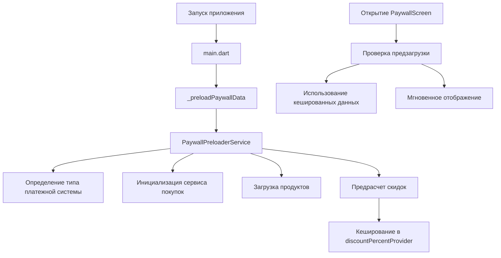

# Система предварительной загрузки Paywall

## Описание проблемы

При первом переходе на экран Paywall пользователи наблюдали "скачки" текста на кнопках из-за того, что:

1. Загружались продукты из магазина приложений
2. Определялся тип платежной системы (App Store, Google Play, RuStore, YooKassa)
3. Пересчитывались цены и скидки
4. Обновлялся интерфейс с новыми данными

Это создавало плохой UX, особенно при медленном интернете.

## Решение

Реализована система предварительной загрузки данных Paywall при запуске приложения:

### 1. PaywallPreloaderService

**Файл:** `lib/services/paywall_preloader_service.dart`

Сервис выполняет:
- Определение типа платежной системы
- Инициализацию сервиса покупок
- Загрузку продуктов из магазина
- Предрасчет скидок
- Кеширование результатов

### 2. Интеграция с запуском приложения

**Файл:** `lib/main.dart`

Добавлен вызов `_preloadPaywallData()` в `_AppWithProvidersState.initState()`, который:
- Запускается в фоне без блокировки UI
- Выполняется параллельно с другой инициализацией
- Обрабатывает ошибки без критических сбоев

### 3. Оптимизация PaywallScreen

**Файл:** `lib/features/subscription/paywall_screen.dart`

Экран теперь:
- Проверяет, была ли выполнена предзагрузка
- Пропускает повторный расчет скидок если данные уже готовы
- Использует предзагруженные значения для мгновенного отображения

## Архитектура

## Поддерживаемые платежные системы

1. **App Store** - стандартные IAP цены
2. **Google Play** - стандартные IAP цены
3. **Google Play (Россия)** - цены YooKassa
4. **RuStore** - фиксированные цены в рублях

## Логирование

Используется префикс `🎯 PAYWALL_PRELOADER:` для всех логов сервиса предзагрузки.

Ключевые сообщения:
- `Начинаем предварительную загрузку данных Paywall`
- `Тип платежной системы: [тип]`
- `Загружено [N] продуктов`
- `Рассчитанная скидка: [N]%`
- `✅ Предварительная загрузка завершена успешно`

## Обработка ошибок

- Ошибки логируются, но не прерывают работу приложения
- При ошибке предзагрузки Paywall работает в обычном режиме
- Fallback на стандартную логику загрузки при первом открытии

## Производительность

- Предзагрузка выполняется асинхронно в фоне
- Не блокирует запуск приложения
- Использует кеширование для избежания повторных вычислений
- Экономит время при первом открытии Paywall на ~1-3 секунды

## Тестирование

Для проверки работы:

1. Очистить данные приложения
2. Запустить приложение
3. Дождаться завершения инициализации
4. Открыть Paywall - тексты должны отображаться мгновенно без перестройки

Проверить логи на наличие сообщений `🎯 PAYWALL_PRELOADER:` для подтверждения работы системы. 